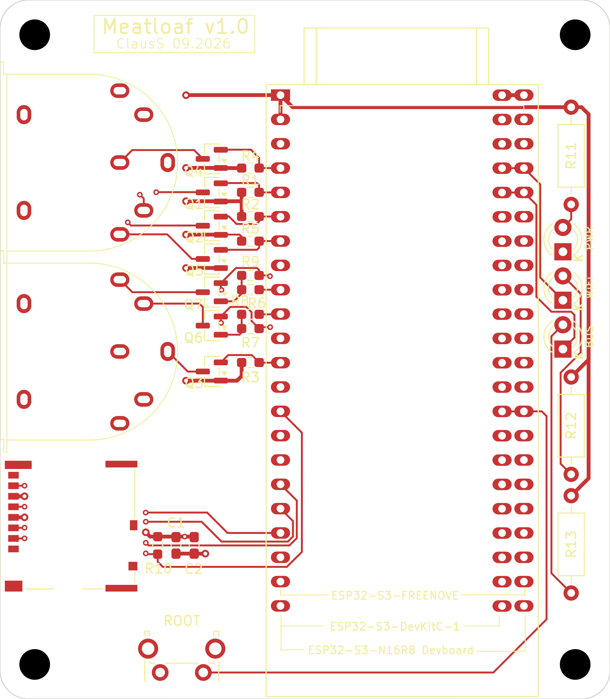

# MeatLoaf PCB v1.0

This document contains the assembly and connection information specific to
carrier-board revision **PCB v1.0**. Do not apply these details to another PCB
revision without checking its own documentation.

## Compatible ESP32-S3 development boards

The carrier provides one common left-hand socket row and two alternative
right-hand socket rows. It supports the following development-board layouts:

| Development-board layout | Right-hand socket row |
| --- | --- |
| [Espressif ESP32-S3-DevKitC-1](https://docs.espressif.com/projects/esp-dev-kits/en/latest/esp32s3/esp32-s3-devkitc-1/user_guide_v1.1.html) | Inner row |
| [Freenove ESP32-S3 WROOM Board](https://github.com/Freenove/Freenove_ESP32_S3_WROOM_Board) (FNK0085) | Outer row |
| [YD-ESP32-S3 development board](https://github.com/vcc-gnd/YD-ESP32-S3) | Outer row |

The firmware provided for PCB v1.0 uses the microSD-card slot on the carrier
board. Although the Freenove ESP32-S3 WROOM Board has its own microSD-card
slot, that slot is not enabled by this firmware. Insert the microSD card into
the carrier-board slot when using the Freenove board.

The socket row is determined by the board's physical dimensions, header
spacing, and pin assignment. Flash and PSRAM capacity are separate from this
mechanical choice and do not determine which socket row to use.

The named layouts are supported by this design. A different memory
variant or another board from the same product family may fit, but it is not
automatically compatible. Compare its complete pinout, header spacing, and
dimensions with the KiCad design before fitting it.

The PCB silkscreen label `ESP32-S3-DevKitC-1` identifies the development-board
layout, not its memory configuration. Determine the installed module's flash
and PSRAM capacity separately and use the
[firmware instructions](../../Firmware/README.md) to select the correct
firmware package.

## Module placement

1. Disconnect USB, IEC, and every other power source.
2. Place the carrier PCB in front of you with the two IEC connectors on the
   **left** and the status LEDs on the **right**.
3. Select the appropriate right-hand socket row:
   - Espressif ESP32-S3-DevKitC-1: **inner** right-hand socket row.
   - Freenove ESP32-S3 WROOM Board: **outer** right-hand socket row.
   - YD-ESP32-S3: **outer** right-hand socket row.
4. Orient the ESP32-S3 development board so that its USB connector or
   connectors point **downward, toward you**.
5. Carefully insert the module into the common left-hand socket row and the
   selected right-hand socket row on the component side of the carrier.
6. Check both ends of both headers. A one-pin offset will connect the wrong
   signals and may damage the module or carrier.
7. Before applying power, verify the `3V3` and `GND` positions against the
   module's own pinout.

The three placement outlines and their names are printed on the PCB
silkscreen. Fit only one ESP32-S3 board at a time; the two right-hand rows are
alternatives, not two simultaneous connections.

## GPIO usage on PCB v1.0

The following table describes the electrical connections made by the carrier
board. These assignments are taken from the current PCB v1.0 schematic and
layout.

| ESP32-S3 GPIO | Carrier-board function | Schematic net / note |
| ---: | --- | --- |
| 0 | ROOT button `SW1` | Navigates to the root directory of the internal flash filesystem |
| 1 | WiFi status LED `D2` | LED control |
| 2 | Bus status LED `D3` | LED control |
| 4 | IEC ATN | `M_ATN` |
| 5 | IEC CLK input | `M_CLK_IN` |
| 6 | IEC DATA input | `M_DATA_IN` |
| 7 | IEC SRQ | `M_SRQ` |
| 8 | IEC RESET | `M_RST` |
| 11 | microSD MOSI/CMD | `MOSI` |
| 12 | microSD clock | `SCK` |
| 13 | microSD MISO/DAT0 | `MISO` |
| 16 | IEC DATA output | `M_DATA_OUT` |
| 17 | IEC CLK output | `M_CLK_OUT` |
| 46 | microSD chip select | `CS` |

The carrier also connects the module's `3V3` and `GND` pins. The module's
`5V` and `EN`/`CHIP_PU` pins are not connected by PCB v1.0.

IEC CLK and DATA use **separate input and output GPIOs** on this carrier:
GPIO5/GPIO17 for CLK and GPIO6/GPIO16 for DATA. Firmware for PCB v1.0 must use
this split-line arrangement. A generic pin map that assigns both directions to
GPIO5 or both directions to GPIO6 does not match the carrier hardware.

GPIOs not listed above are not connected by the carrier, but they are not
necessarily free for arbitrary use: an installed development board may use
them for its own RGB LED, USB interface, camera connector, or other onboard
hardware. Do not enable a module-local peripheral if it drives a GPIO used in
the table above.

## Firmware selection

Firmware selection depends on the installed module's flash and PSRAM capacity
and must also match the carrier board's GPIO assignments and hardware
configuration. The development-board manufacturer and socket-row position
alone do not determine the correct firmware variant. Refer to the
[firmware instructions](../../Firmware/README.md) before flashing.

## Design and production files

- [Schematic PDF](PDF/Meatloaf-PCB-v1.0-Schematic.pdf)
- [KiCad project](KiCad/)
- [Production files](Production/)
- [PCB images](Images/)
- [Complete STEP assembly](3D/Meatloaf-PCB-v1.0-Assembly.step)

The editable KiCad project is the authoritative source if this document and a
design file ever disagree.
