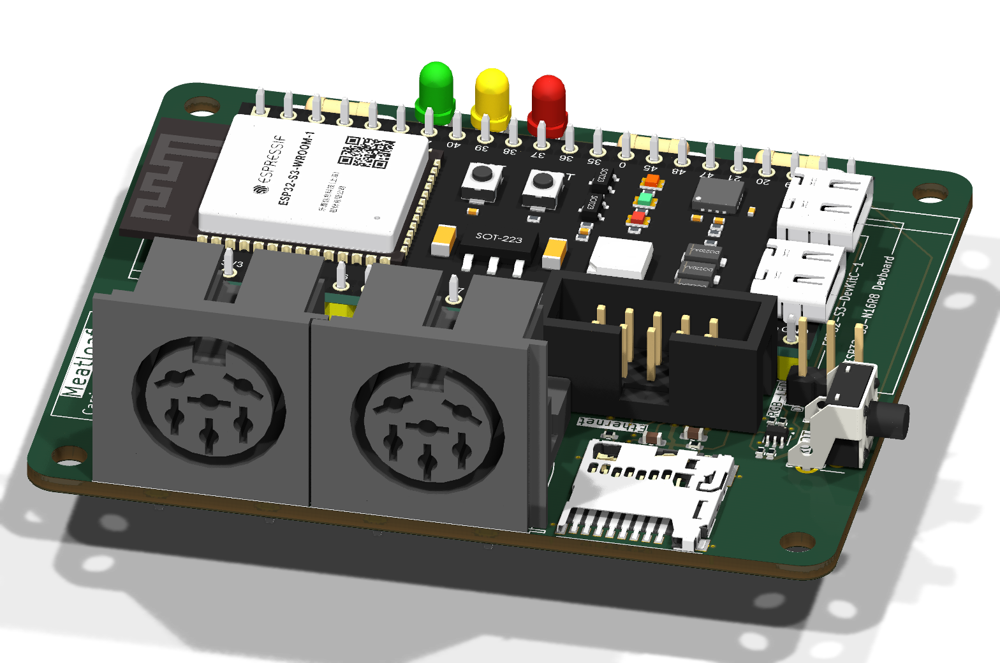

# Meatloaf PCB v1.1a

PCB v1.1a uses discrete BC847BS stages for the IEC inputs.
The IEC outputs use separate BC847BS open-collector stages. The microSD
socket uses SPI2. The W5500 header uses SPI3.

*The two round 6-pin DIN sockets in the foreground connect to the Commodore IEC bus.*

[Additional 3D view](Images/PCB-v1.1a-KiCad-3D.png)

## Changes from PCB v1.0

- **IEC:** v1.0 already separates CLK and DATA inputs and outputs. v1.1a
  also separates ATN, SRQ and RESET, with discrete BC847BS input stages
  and open-collector output drivers.
- **microSD:** Card Detect uses GPIO3 with an external 10 kΩ pull-up and
  reads LOW when a card is inserted. SD chip select moves from GPIO46 to
  GPIO14, freeing GPIO46 for IEC RESET output.
- **Ethernet:** J4 adds a W5500 module connection with separate chip select
  and interrupt lines on a dedicated SPI3 bus.
- **RGB:** J5 adds a 5 V addressable LED connection with non-inverting
  level shifting from GPIO48.

## GPIO assignments

| ESP32-S3 GPIO | Carrier-board function |
| ---: | --- |
| 0 | ROOT / boot button |
| 1 | WiFi status LED, active low |
| 2 | Bus status LED, active low |
| 3 | microSD Card Detect, low when inserted |
| 4 | IEC ATN input |
| 5 | IEC CLK input |
| 6 | IEC DATA input |
| 7 | IEC SRQ input |
| 8 | IEC RESET input |
| 9 | W5500 interrupt |
| 10 | W5500 chip select |
| 11 | microSD SPI2 MOSI |
| 12 | microSD SPI2 clock |
| 13 | microSD SPI2 MISO |
| 14 | microSD chip select |
| 15 | IEC ATN open-collector output |
| 16 | IEC DATA open-collector output |
| 17 | IEC CLK open-collector output |
| 18 | IEC SRQ open-collector output |
| 39 | W5500 SPI3 clock |
| 40 | W5500 SPI3 MISO |
| 41 | W5500 SPI3 MOSI |
| 46 | IEC RESET open-collector output |
| 48 | External RGB-module data |

GPIO3 and GPIO46 are ESP32-S3 strapping pins. The external circuits shown in
the schematic define their reset state; module-specific boot and JTAG behavior
must nevertheless be checked for the exact ESP32-S3 board being installed.

## Ethernet connector

`J4` is a 2x5, 2.54 mm header for a plug-in W5500 Ethernet module. The RJ45
socket and Ethernet magnetics are located on the module, not on the carrier
board. W5500 modules are sold with different connector layouts, so their
pinout must be compared with this table before they are connected. The square
pad identifies pin 1.

| J4 pin | Signal | ESP32-S3 GPIO / function |
| ---: | --- | --- |
| 1 | NC | Not connected |
| 2 | SCK | GPIO39, SPI3 clock |
| 3 | INT | GPIO9, W5500 interrupt |
| 4 | SCS | GPIO10, W5500 chip select |
| 5 | NC | Not connected |
| 6 | MOSI | GPIO41, SPI3 controller-to-peripheral data |
| 7 | GND | Ground |
| 8 | MISO | GPIO40, SPI3 peripheral-to-controller data |
| 9 | NC | Not connected |
| 10 | 3V3 | 3.3 V module supply |

The W5500 uses a dedicated SPI3 bus. `J4` has no W5500 reset signal.
Use a module with suitable local power-on reset behavior.

## Addressable RGB LED connector

`J5` is intended for a serially addressable RGB LED module or short LED chain,
not for a conventional four-wire analog RGB LED. The firmware drives GPIO48
with the WS2812B protocol and GRB color order. It is configured for five LEDs
by default; the LED count and brightness can be changed in the Meatloaf LED
strip configuration.

| J5 pin | Signal | Connection |
| ---: | --- | --- |
| 1 | DATA | Non-inverting 5 V signal from GPIO48 via Q9; connect to the first LED's `DIN` |
| 2 | +5V | Connected directly to ESP32-S3 module pin `5V_21` |
| 3 | GND | Ground |

`J5` is routed for 5 V WS2812B-compatible LEDs. Its supply is taken directly
from pin `5V_21` of the installed ESP32-S3 module; the carrier board has no
separate 5 V source on this net. Q9 and R20–R23 translate the GPIO48 signal
to 5 V without changing its logical polarity. Verify that the selected
ESP32-S3 module exposes 5 V at this pin for the chosen USB/power configuration
and can supply the total LED current. Do not feed an independent 5 V source
into `J5` pin 2 while the module or either USB connector can energize that net.
If the LEDs need a separate supply, leave pin 2 disconnected and connect the
external supply ground to pin 3.

## Firmware

Use a [v1.1 firmware build with dedicated W5500 SPI3](../../Firmware/v1.1/README.md#spi3-hardware).

## Design files

- [KiCad project](KiCad/Meatloaf.kicad_pro)
- [STEP assembly](3D/Meatloaf-PCB-v1.1a-Assembly.step)
- [Manufacturing files](Production/)
