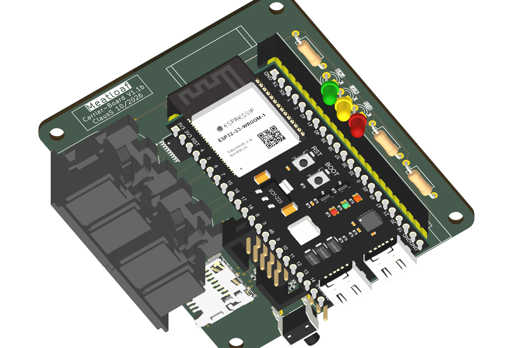

# Meatloaf PCB v1.1b

PCB v1.1b replaces the discrete IEC input stages of [v1.1a](../PCB-v1.1a/README.md)
with a 74LVC541A buffer. It retains the BC847BS open-collector output stages,
the W5500 header and the 5 V RGB data level shifter.

The rendering and STEP assembly include the female socket strips beneath the
ESP32-S3 development board so that its installed height is represented.

## IEC input buffer

The 74LVC541A buffers ATN, CLK, DATA, SRQ and RESET without inverting them.
The IEC output stages retain their existing polarity. The
[GPIO assignments](../PCB-v1.1a/README.md#gpio-assignments),
[W5500 connector](../PCB-v1.1a/README.md#ethernet-connector), and
[RGB connector](../PCB-v1.1a/README.md#addressable-rgb-led-connector)
are shared with v1.1a.

## Directory contents

- [`3D/Meatloaf-PCB-v1.1b-Assembly.step`](3D/Meatloaf-PCB-v1.1b-Assembly.step)
  is the complete mechanical STEP assembly exported from the v1.1b PCB.
- [`KiCad/`](KiCad/) contains the editable schematic, PCB, project file,
  project libraries, and the local 3D models referenced by the PCB.
- [`Images/`](Images/) contains the verified KiCad rendering.
- [`PDF/`](PDF/) contains the retained component documentation for the Molex
  503398-1892 microSD connector, the 74LVC541A input buffer, and the BC847BS
  dual transistors used by the design.
- [`Production/`](Production/) contains the current Gerber/drill archive,
  BOM, position data, designator data, and IPC netlist.

The KiCad project is the authoritative design source. Before ordering boards,
inspect the Gerber archive and placement data in independent viewers and make
sure every file belongs to revision v1.1b.

## Firmware

PCB v1.1b uses the common v1.1 configuration with split IEC lines,
SD Card Detect on GPIO3, SD chip select on GPIO14 and a dedicated W5500 SPI3 bus.
See [v1.1 firmware compatibility](../../Firmware/v1.1/README.md#spi3-hardware).

## Physical prototype validation

The assembled PCB v1.1b prototype was tested with no fault detected in the
following areas before the 2026-11-01 +5 V routing update:

1. IEC operation with normal and accelerated transfers, including loading,
   timing, and signal levels.
2. SD-card insertion and removal while Ethernet was active.
3. W5500 module pinout, startup behavior, and sustained network operation.
4. 3.3 V rail minimum and regulator temperature under combined WiFi,
   Ethernet, SD-write, and RGB load.
5. Connector orientation, microSD insertion clearance, button access, and
   enclosure fit.

## Third-party material

The project contains third-party footprints, symbols, models, and component
documentation. Their original license and attribution files remain with the
corresponding material. The repository's project license does not replace
those third-party terms.
