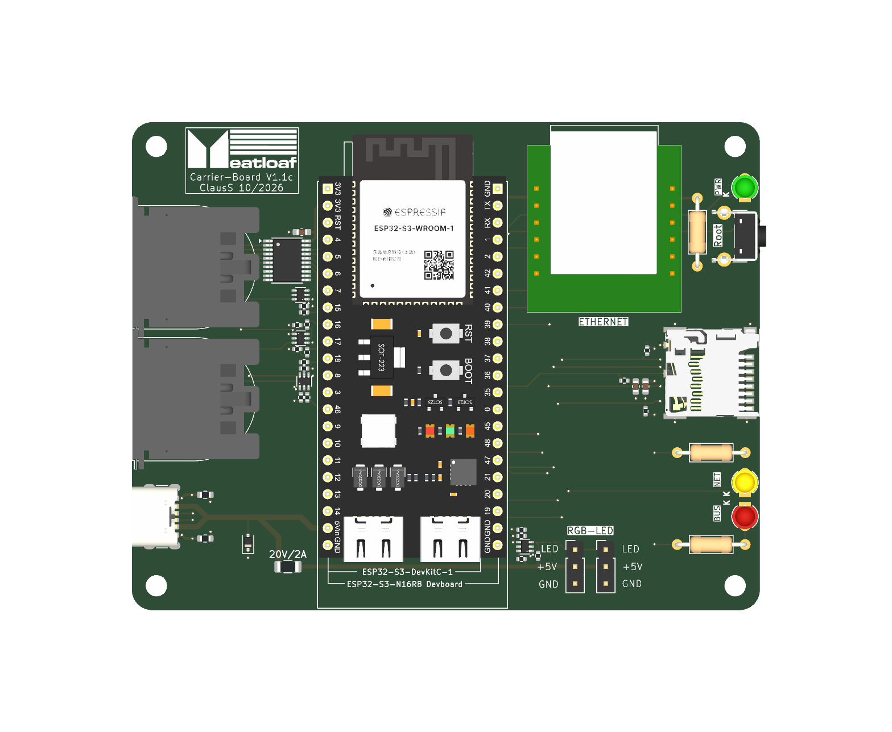
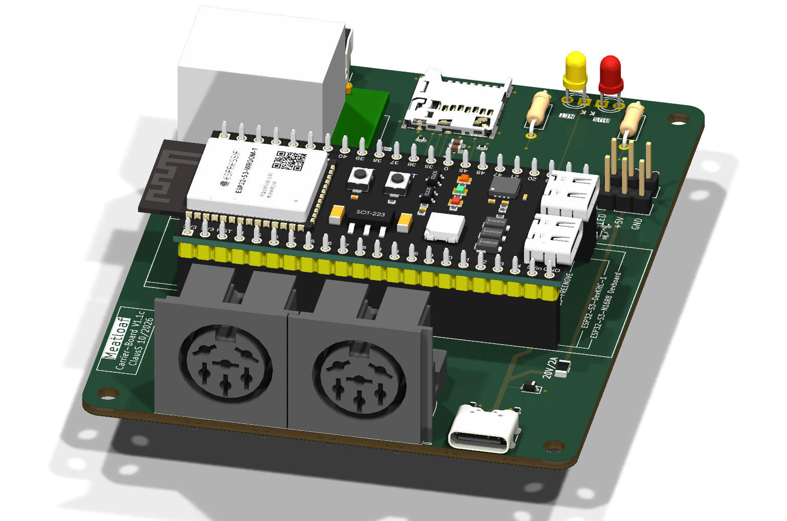

# Meatloaf PCB v1.1c

PCB v1.1c retains the 74LVC541A IEC input buffer and BC847BS
open-collector output stages of v1.1b. It adds a USB-C power input,
a footprint for a 12-pin W5500 Mini Ethernet module, and two RGB headers.

*The two round 6-pin DIN sockets in the foreground connect to the Commodore IEC bus.*

## Power and connections

- P1 is a 5 V USB-C power input. CC1 and CC2 each have a 5.1 kΩ pull-down.
  VBUS connects directly to the ESP32 module's 5 V rail. D4 (PESD5V0S1BA)
  is on this rail. F1 (20 V / 2 A in the BOM) feeds the RGB branch.
  Check the power path before connecting both carrier and module USB power.
- P4 is the W5500 Mini module footprint. Its 3.3 V pins are 8 and 9,
  with GND on 1, 2 and 7. SPI3 MOSI (GPIO41) is on pin 3, SCK (GPIO39)
  on pin 4 and MISO (GPIO40) on pin 12. CS (GPIO10) is on pin 5 and
  INT (GPIO9) on pin 6. Pin 11 (RST) has no carrier connection to an ESP32 GPIO.
  Verify the module's pinout and orientation before fitting it.
- J1 and J2 share the same non-inverting 5 V data signal from GPIO48
  through Q4 and R19–R22. Both headers use pin 1 for data, pin 2 for
  fused +5 V and pin 3 for GND. Both receive the same LED data stream.
- J3 and J4 carry IEC. J5 is the microSD socket.

## Firmware

The IEC, SD, W5500 and RGB GPIO assignments match the
[common v1.1 pin map](../PCB-v1.1a/README.md#gpio-assignments). See
[v1.1 firmware compatibility](../../Firmware/v1.1/README.md#spi3-hardware).

## Design files

- [KiCad project](KiCad/Meatloaf.kicad_pro)
- [STEP assembly](3D/Meatloaf-PCB-v1.1c-Assembly.step)
- [Manufacturing files](Production/)
- [Component datasheets](PDF/)
