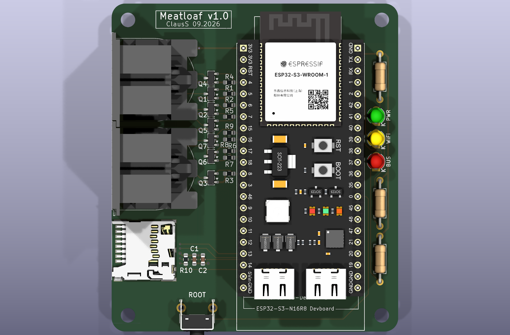

# MeatLoaf-Hardware-ClausS — Hardware

This directory contains the hardware designs and production documentation for
the MeatLoaf carrier-board revisions published in this repository.

## Directory structure

```text
Hardware/
├── PCB-v1.0/
│   ├── README.md     # Revision-specific compatibility, placement, and GPIO information
│   ├── 3D/           # Complete mechanical STEP assembly
│   ├── Images/       # PCB plots, assembly drawing, and 3D renders
│   ├── KiCad/        # Editable KiCad project, schematics, and PCB layout
│   ├── PDF/          # PDF documentation, including schematic exports
│   └── Production/   # PCB manufacturing and assembly files, including Gerbers and BOMs
└── README.md
```

## Published hardware revisions

| Revision | Status | Documentation | Design and production files |
| --- | --- | --- | --- |
| PCB v1.0 | Published | [Compatibility, assembly, and GPIO assignments](PCB-v1.0/README.md) | [KiCad](PCB-v1.0/KiCad/) · [Schematic PDF](PCB-v1.0/PDF/Meatloaf-PCB-v1.0-Schematic.pdf) · [Production](PCB-v1.0/Production/) · [3D](PCB-v1.0/3D/) · [Images](PCB-v1.0/Images/) |



*The image shows the currently published PCB v1.0 revision. It may be replaced
when a newer revision becomes the current reference design.*

Each revision directory is self-contained and normally uses the following
structure:

- **`3D/`** contains mechanical STEP exports where provided.
- **`Images/`** contains PCB plots, assembly drawings, and rendered 3D views.
- **`KiCad/`** contains the editable hardware design. Open the project in KiCad to inspect the schematic and PCB layout.
- **`PDF/`** contains exported schematics and component documentation.
- **`Production/`** collects the manufacturing and assembly outputs for the
  revision, including Gerber and drill files, bills of materials (BOMs), and
  other production-related files where provided.

Future PCB revisions can be added as separate directories alongside
`PCB-v1.0/`. Do not mix documentation, design files, or manufacturing outputs
from different revisions.

## Hardware overview

The project provides custom **ESP32-based MeatLoaf carrier boards**. Features,
module layouts, pin assignments, physical connections, and supported firmware
may differ between revisions. Use the documentation inside the selected
revision directory as the authoritative source for compatibility and assembly.

## Before manufacturing or assembly

1. Review the KiCad schematic and PCB layout for the selected revision.
2. Check the files in `Production/` and ensure that the Gerbers, drill files, BOM, and assembly information belong to the same PCB revision.
3. Verify connector orientation, component footprints, supply voltages, and IEC interface wiring.
4. Review any revision-specific notes and confirm the compatibility of the ESP32-S3 module you intend to use.
5. Check the applicable rights and licenses before redistributing third-party libraries, footprints, or 3D models.

## Firmware

Prebuilt firmware packages and installation information are provided separately
in [`Firmware/`](../Firmware/README.md). Select a package that matches the
hardware revision, GPIO configuration, flash capacity, and any other documented
requirements.

## License

The project's original hardware design materials are subject to the terms in [`LICENSE.md`](../LICENSE.md). A German-language version is available in [`LIZENZ.md`](../LIZENZ.md). Third-party files may be governed by separate licenses or usage restrictions.

This project uses a custom non-commercial hardware license; it is **not** an OSHWA-compliant open-source hardware license.
