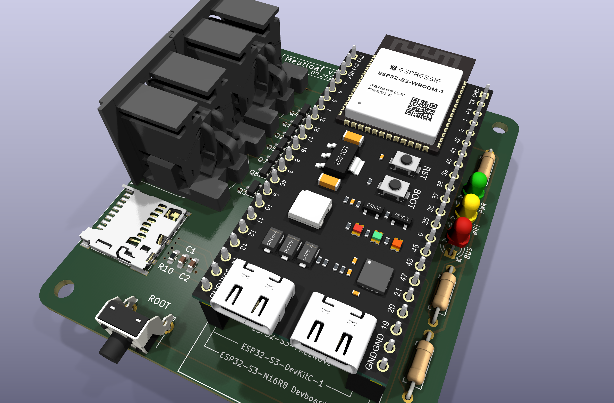

# MeatLoaf Hardware

Hardware designs and ready-to-flash firmware packages for the [MeatLoaf](https://github.com/idolpx/meatloaf) project.

MeatLoaf is an ESP32-based interface for Commodore computers. It connects to the IEC serial bus and can provide access to disk images, SD-card files, network services, and other MeatLoaf firmware features.

This repository contains an independent hardware implementation maintained by Claus Schlereth. The original MeatLoaf firmware is developed separately in the upstream MeatLoaf repository.



*The image shows the currently published PCB v1.0 revision. It may be replaced
when a newer hardware revision becomes the current reference design.*

## Available hardware revisions

| Revision | Status | Hardware documentation | Firmware |
| --- | --- | --- | --- |
| PCB v1.0 | Published | [Documentation](Hardware/PCB-v1.0/README.md) · [KiCad files](Hardware/PCB-v1.0/KiCad/) · [Production files](Hardware/PCB-v1.0/Production/) | [Firmware packages](Firmware/v1.0/) · [Installation instructions](Firmware/README.md) |

Each hardware revision has its own design, documentation, images, and manufacturing files. Files from different revisions must not be mixed.

The table above is the starting point for revision-specific compatibility,
placement, GPIO assignments, schematics, PCB images, KiCad sources, 3D data,
and manufacturing files. The [hardware overview](Hardware/README.md) provides a
revision-independent index of the available design material.

## Getting started

### Using an assembled board

1. Identify the PCB revision and the installed ESP32 module configuration.
2. Download the matching firmware package from the appropriate [`Firmware/`](Firmware/) revision directory or from GitHub Releases.
3. Follow the [firmware installation instructions](Firmware/README.md).
4. Verify that all connections are correct before switching on the connected Commodore computer.

### Building the hardware

Before ordering or assembling a PCB:

1. Open the documentation for the required hardware revision.
2. Review its schematic and PCB layout.
3. Make sure all manufacturing files belong to the same revision.
4. Check component availability, footprints, connector orientation, and ESP32-S3 module compatibility.
5. Review the applicable license and third-party notices.

The files under `Production/` are intended for PCB manufacturing and assembly. The editable KiCad project remains the authoritative design source.

## Firmware

Firmware packages are hardware-specific and may also differ by flash capacity,
PSRAM capacity, GPIO assignments, and other board configuration details. A
development-board name or matching connector position alone does not determine
the correct package.

Use the firmware link for the selected hardware revision and follow the
[`Firmware/README.md`](Firmware/README.md) instructions to identify the module
and choose a compatible package. Do not assume that firmware for one revision
or memory configuration is suitable for another.

## Repository structure

```text
.
├── Hardware/
│   ├── README.md
│   └── PCB-v1.0/
│       ├── README.md
│       ├── 3D/
│       ├── Images/
│       ├── KiCad/
│       ├── PDF/
│       └── Production/
├── Firmware/
│   ├── README.md
│   └── v1.0/
├── LICENSE.md
└── LIZENZ.md
```

Future hardware revisions will be added as separate directories, for example `Hardware/PCB-v1.1/` or `Hardware/PCB-v2.0/`.

## Revision history

| Date | Revision | Summary |
| --- | --- | --- |
| 2026-10-21 | PCB v1.0 | Initial published hardware revision with KiCad sources, schematic PDF, PCB images, 3D assembly, production files, and N8R8/N16R8 firmware packages |

Detailed technical changes should be documented with the files for the corresponding hardware revision. This table records only published repository revisions.

## Project status

This is a hobby hardware project under active development.

Features, test status, component choices, and firmware compatibility may differ between hardware revisions. Always consult the documentation for the exact PCB revision instead of assuming that information for another revision also applies.

## License and third-party materials

The original hardware design materials are provided under the project's custom non-commercial hardware license:

- [English translation](LICENSE.md)
- [Verbindliche deutsche Fassung](LIZENZ.md)

Private builds and non-profit group orders at documented actual cost are permitted under the conditions of that license. Commercial use requires separate written permission.

Firmware, KiCad libraries, component models, trademarks, and other third-party materials may be governed by separate licenses or usage conditions. The project license does not grant additional rights to those materials.

## Safety notice

The project is provided for experimentation and hobby use without a guarantee of functionality, electrical safety, regulatory compliance, or fitness for a particular purpose.

Check wiring, connector orientation, supply voltage, component ratings, and the selected hardware revision before powering the board.
